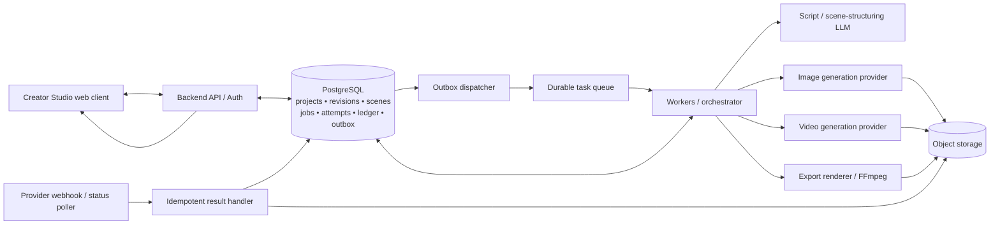

# Briqen Creator Studio — Backend Architecture Plan

**Purpose:** A focused design for Briqen's script-to-video workflow, based on the supplied *Briqen AI / First Round — Briqen Creator Studio Backend Architecture* exercise. This is an architecture exercise, not a request to build a production video-generation platform.

## 1. Product framing and design goals

The exercise describes a marketer who drafts and revises an AI-assisted script, splits it into scenes, generates an image or video for each scene, edits scene order and timing, and exports a draft video. Briqen's public product description also frames Briqen MI around marketing intelligence that flows into campaign-organised briefs, scripts and video edits. That is useful product context, but it does **not** reveal Briqen's internal architecture; the design below is a proposal, not a claim about its existing stack.

**Goals**

1. Preserve project, script and scene edits as durable records.
2. Keep long-running LLM, image, video and rendering work asynchronous.
3. Never lose an accepted asset because another scene's generation failed.
4. Make API requests, queue deliveries, provider callbacks and worker retries safe to repeat.
5. Charge once per user-requested generation action; distinguish a retry from a deliberate new generation.
6. Export the exact scene/asset/timing version the user asked to render.

**Core invariants**

- PostgreSQL is the source of truth for project state, jobs, attempts, asset metadata, billing and export state. A queue or cache is not the source of truth.
- A generation *action* represents one user intent. A provider *attempt* is one execution attempt for that action. They are different records.
- Retrying the same action reuses its `action_id` and its one credit-ledger row. Deliberate regeneration gets a new `action_id` and a higher scene generation epoch.
- Generated assets are immutable. A scene points to the currently selected asset; a late result cannot blindly overwrite that pointer.
- Queue delivery and callbacks are treated as at-least-once. Consumers are idempotent; do not assume exactly-once execution.
- A local timeout means “outcome unknown” unless the provider confirms failure. It does not prove that generation stopped.

## 2. Proposed architecture



**Responsibilities**

- **Web client:** edits script, scene order and durations; starts generation/export; shows per-scene job status; previews selected assets. It never waits on a generation request for a minute.
- **API:** authentication and workspace isolation, validation, optimistic concurrency, short database transactions, job creation, status reads and signed media URLs.
- **PostgreSQL:** canonical workflow state and transactional outbox. Use unique constraints and conditional updates to make duplicate requests harmless.
- **Outbox dispatcher + queue:** publish committed work reliably. Queue messages contain IDs, not large media payloads. Duplicate deliveries are expected and harmless.
- **Workers:** script drafting/splitting, provider adapters, result processing and export rendering. Use leases/heartbeats, bounded attempts, timeouts and exponential backoff with jitter.
- **Generation providers:** external LLM/image/video services accessed through adapters so provider-specific request IDs, callbacks, rate limits and idempotency behavior are isolated.
- **Object storage:** generated images, clips, thumbnails and final exports. Store bytes here, not in PostgreSQL. Persist object keys, checksums, MIME type, dimensions, duration and ownership in the database. Serve via short-lived signed URLs.
- **Result handler:** accepts signed webhooks and/or polls provider status; deduplicates events and applies the late-result acceptance rule.

For a first release, one API service, one relational database, one durable queue, a small worker pool, object storage and provider adapters are sufficient. Do not introduce microservices or a workflow engine unless operational needs justify them.

## 3. Data model — records to keep

| Record | Important fields / purpose |
|---|---|
| `projects` | `id`, `workspace_id`, `owner_id`, `title`, `status`, `current_script_revision_id`, `edit_version`, timestamps. Every query is scoped to the authenticated workspace. |
| `script_revisions` | `id`, `project_id`, `revision_no`, `parent_revision_id`, `content`, `created_by`, `prompt/model metadata`, timestamp. Immutable; edits create a new revision instead of silently mutating history. Unique `(project_id, revision_no)`. |
| `scenes` | `id`, `project_id`, `source_revision_id`, `scene_number`, `position`, `narration`, `visual_prompt`, `duration_ms`, `selected_asset_id`, `generation_epoch`, `active_generation_job_id`, `version`. Scene identity is stable while order/timing can change. |
| `generation_jobs` | `id`, `action_id` (unique), `project_id`, `scene_id`, `generation_epoch`, `kind` (`image`/`video`), provider/model, input snapshot/hash, `status`, `attempt_count`, provider request reference, timestamps/error. One row per user action. |
| `job_attempts` | `id`, `job_id`, `attempt_no`, provider request ID, provider idempotency key, status, start/finish time, timeout/error details. Unique `(job_id, attempt_no)`; provider request ID unique when present. |
| `assets` | `id`, project/scene/job/attempt IDs, immutable object key, media type, MIME type, size, checksum, dimensions, duration, provider metadata, created time. An asset can exist without being selected. |
| `credit_ledger` | `id`, `action_id` (unique), user/workspace, amount, state (`RESERVED`, `CAPTURED`, `RELEASED`), timestamps/reason. Enforce one customer charge/reservation per `action_id` with a database unique constraint. |
| `outbox_events` | `id`, event key (unique), aggregate/job ID, event type, payload, published timestamp, retry/error fields. Insert in the same transaction as the job/ledger changes. |
| `exports` | `id`, project ID, frozen edit version and ordered scene/asset/timing snapshot, status, output asset ID, error, created time. Export always renders from the saved snapshot. |

A separate `provider_costs` record can track actual external spend per attempt. Do not confuse internal provider spend with the single customer credit charge for a logical action.

## 4. API behaviour and one two-scene trace

**Representative endpoints**

- `POST /projects` — create project.
- `POST /projects/{id}/script-revisions` — save a new immutable script revision.
- `POST /projects/{id}/scenes:split` — create/update scenes from a selected revision.
- `PATCH /projects/{id}/scenes/order` and `PATCH /scenes/{id}` — edit ordering and duration; require `edit_version`/ETag to prevent lost updates.
- `POST /scenes/{id}/generation-jobs` — start image/video generation with a client `Idempotency-Key`.
- `POST /generation-jobs/{id}/retry` — retry/reconcile the same logical action; no new customer charge.
- `POST /scenes/{id}/regenerations` — explicitly create a new generation action/epoch and a new charge.
- `GET /generation-jobs/{id}` — read status and progress.
- `POST /projects/{id}/exports` / `GET /exports/{id}` — start/check an asynchronous export.
- `POST /webhooks/{provider}` — verify provider signature, deduplicate event, then hand off to result handler.

**If generation takes a minute:** the generation endpoint returns `202 Accepted`, not an open HTTP request. Example: `{ job_id, status: "queued", status_url: "/generation-jobs/{id}" }`. The UI shows a pending state and reads the status endpoint (with a modest backoff) or receives SSE/WebSocket progress. Job status and progress are persisted in PostgreSQL, so refresh/reconnect does not lose state. Return a request/correlation ID for support and tracing.

**Two-scene walkthrough**

1. The marketer creates project `P1`, drafts a script and saves immutable revision `R1`. The API persists `projects` and `script_revisions` and returns the revision ID.
2. The split operation creates stable scenes `S1` and `S2`, each linked to `R1`, with narration, visual prompt, order and initial duration. The client can edit their order/timing; changes increment the project `edit_version`.
3. The user requests an image for `S1` and a video for `S2`. In separate short DB transactions, the API creates one logical job/action and one `RESERVED` ledger row per request, plus an outbox event. A unique `action_id` prevents duplicate charge rows. The dispatcher publishes job IDs to the queue.
4. A worker generates Scene 1's image, uploads it to object storage, inserts immutable asset metadata, marks its job successful and atomically sets `S1.selected_asset_id`. This accepted image is independent of Scene 2 and is never deleted or cleared by Scene 2's failure.
5. Scene 2's provider call exceeds the worker's wait timeout. Its state becomes `UNKNOWN`/`RECONCILING`, not immediately “failed”, because the provider may still be processing. The user taps Retry. The API reuses the same logical job/action and ledger row. The worker first checks provider status or reuses the provider's idempotency key; it only submits a genuinely new provider attempt when the prior attempt is known not to be running/accepted. If the provider cannot offer idempotency or status lookup, do not blindly resubmit an ambiguous request; keep reconciling or expose a clear manual decision.
6. Suppose the retry's result is accepted and selected first. The first attempt's callback then arrives late. The handler verifies the callback, deduplicates it, and may store its output as an unselected asset for audit, but it cannot change `S2.selected_asset_id` because the job is already terminal-successful (or its generation epoch is no longer current). If the first attempt had committed first, the retry result would instead be the late/unselected one. **The first valid success that atomically commits for the current action wins; later callbacks never overwrite it.**
7. A deliberate regeneration of `S2` creates a new `action_id`, increments `S2.generation_epoch`, reserves a new customer charge and changes `active_generation_job_id`. The previously accepted asset remains visible until the new job succeeds. Only a result matching the current job and epoch can become selected; results from older jobs are stored as stale/unselected and cannot roll the scene backward.
8. On Export, the API snapshots ordered scene IDs, selected asset IDs, durations and edit version into an `exports` row and queues rendering. The renderer combines exactly that snapshot, stores the output, and updates export status. Later scene edits do not silently change an export already in progress.

## 5. Retry, late-result and billing rules

**Retryable failures:** transient network errors, provider 5xx, rate limits (respect `Retry-After`), worker crashes and timeouts after recording the attempt. Use bounded exponential backoff with jitter; cap attempts and move exhausted jobs to a visible failed/manual-reconcile state. Do not retry invalid prompts, authorization failures, unsupported media settings or policy rejections without changing the input.

**Timeout is an ambiguous outcome:** query the provider by request ID or receive its callback before launching another paid provider request. Where supported, use a stable provider idempotency key for transport retries. If no provider idempotency/status API exists, the system cannot honestly guarantee no duplicate provider-side charge after an ambiguous timeout; avoid blind resubmission and surface reconciliation. The platform can still guarantee one customer ledger charge per action.

**Atomic result acceptance:** save a valid result as an immutable asset, then in one DB transaction lock/check the job and scene. Promote it only if (a) the job has not already committed a success, (b) the scene's `active_generation_job_id` is this job, and (c) the scene's `generation_epoch` equals the job's epoch. Otherwise leave the asset unselected. This handles duplicate/out-of-order callbacks and stale workers.

**Billing:** create the unique ledger row when accepting the user action (reservation). Retry reuses it. On success, capture/update that row once; on terminal failure, release it once. A regeneration creates a different action and therefore a distinct ledger row. Use a DB unique constraint plus a transaction; do not rely only on frontend button disabling or a Redis lock.

### Pseudocode (16 lines)

```text
retry(job_id, request_key):
  job = lock_job(job_id); assert request_key maps to job.action_id
  if job.status == SUCCEEDED: return job
  assert job.status in {FAILED, UNKNOWN, RETRY_WAIT}
  attempt = latest_attempt(job)
  if attempt.status == UNKNOWN and provider.can_lookup:
      outcome = provider.lookup(attempt.provider_request_id)
      if outcome == RUNNING: return job
      if outcome == SUCCEEDED: return accept_result(job, attempt, outcome.asset)
  if attempt.status == UNKNOWN and not provider.safe_idempotent_retry:
      set_status(job, RECONCILING); return job
  enqueue_retry(job.id, same_action_id=job.action_id)  # no new ledger row

accept_result(job, attempt, output):
  asset = persist_immutable_asset(output)  # object storage + metadata
  begin transaction; lock(job, job.scene)
  if job.status in {QUEUED, RUNNING, RETRY_WAIT, UNKNOWN, RECONCILING}
     and scene.active_generation_job_id == job.id
     and scene.generation_epoch == job.generation_epoch:
      mark_attempt_succeeded(attempt); mark_job_succeeded(job)
      scene.selected_asset_id = asset.id; capture_ledger_once(job.action_id)
  else: mark_asset_unselected(asset)  # late, duplicate or fenced result
  commit; return job
```

For a deliberate regeneration, create a **new** job/action, increment the scene epoch and create a new ledger row; do not route it through `retry()`.

## 6. First release, deferrals and ship checks

**Build first:** authenticated project CRUD; immutable script revisions; simple scene splitting/editing; per-scene image/video job records; one provider adapter per supported media type; durable queue + outbox; persistent job status; immutable object storage assets; selected-asset pointer; idempotent billing ledger; basic asynchronous export; logs and a minimal failure/retry UI.

**Defer:** multi-provider model routing and automatic quality ranking; collaborative real-time editing; complex timelines/transitions/audio mixing; advanced asset library/search; arbitrary workflow branching; provider marketplace; autoscaling optimisation; sophisticated billing plans/usage analytics. Keep adapter and schema boundaries extensible without implementing these now.

**Two checks before shipping**

1. **Fault-injection / race test:** provider accepts a request but the worker times out; user retries; duplicate and out-of-order callbacks arrive. Assert one ledger charge for the action, accepted Scene 1 asset unchanged, a single selected Scene 2 asset, and no stale result overwrites a newer generation epoch.
2. **End-to-end project/export test:** create a two-scene project, revise the script, reorder scenes and change durations, generate both assets, export, then modify the project. Assert the export uses its frozen snapshot, media is retrievable through authorised signed URLs, and one workspace cannot access another workspace's project/assets.

**Assumption that could change the design:** the chosen image/video providers expose a stable request ID and either idempotency keys, status lookup or reliable signed webhooks. If they do not, ambiguous timeouts require a reconciliation/manual-confirmation path; safely auto-resubmitting and guaranteeing zero provider-side duplicate spend are not both possible.

## 7. Prior work and AI-use disclosure for the submission

- **Prior work:** include one real repo/demo/write-up and name the exact parts personally owned. If work is private, describe it briefly. Do not invent a public link, metrics or ownership. If no directly relevant sample is shareable, say so and give a truthful short description of the closest backend/AI work.
- **AI appendix:** outside the two-page limit, include the task-related prompts and answer excerpts relied on (or a share link), state which AI tools were used, redact secrets, and describe what was changed or verified. Do not claim tests, provider capabilities or implementation work that were not actually checked.

## 8. Research notes and references

The assignment PDF is the source of requirements. External references below support general reliability patterns; they do not establish Briqen's internal implementation or provider capabilities.

1. Briqen public product description — marketing intelligence, scripts and campaign-organised video editing: https://briqen.com/ and https://apps.apple.com/in/app/briqen-mi/id6834710907
2. AWS Well-Architected, *Make mutating operations idempotent* — request tokens and deduplication: https://docs.aws.amazon.com/wellarchitected/2025-02-25/framework/rel_prevent_interaction_failure_idempotent.html
3. AWS Builder's Library, *Timeouts, retries, and backoff with jitter* — ambiguous outcomes, bounded retries and jitter: https://aws.amazon.com/builders-library/timeouts-retries-and-backoff-with-jitter/
4. AWS Prescriptive Guidance, *Transactional outbox pattern* — atomic DB state + event publication and idempotent consumers: https://docs.aws.amazon.com/prescriptive-guidance/latest/cloud-design-patterns/transactional-outbox.html
5. Google Cloud Tasks, *Understand Cloud Tasks* — at-least-once delivery and idempotent handlers: https://cloud.google.com/tasks/docs/dual-overview
6. Temporal documentation, *Activities* — isolate long-running external calls and design retryable activities to be idempotent: https://docs.temporal.io/activities
